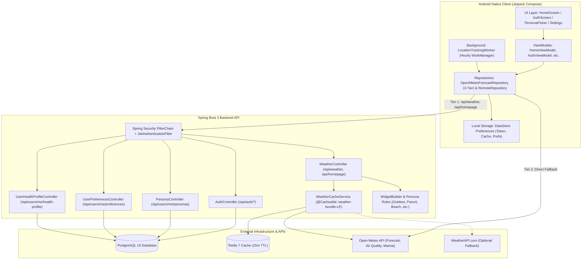
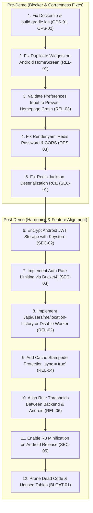

# WeatherEngine Full Codebase & Architecture Audit Report

> **Target**: WeatherEngine (Kotlin + Spring Boot 3 backend, native Android app, PostgreSQL, Redis 7, Open-Meteo, JWT Auth, Render deployment)  
> **Mode**: Read-Only Comprehensive Security, Reliability, Architecture, and Bloat Audit  
> **Date**: October 2026  
> **Auditor**: Senior Backend & Security Specialist

---

## 1. Executive Summary

A comprehensive read-only audit was conducted across the entire **WeatherEngine** repository, covering the Spring Boot 3 backend (`weatherengine-backend`), the Jetpack Compose Android client (`weatherengine-android`), Docker configurations, and Render deployment specifications (`render.yaml`).

### Overall Risk Rating: **HIGH**

While the core weather calculation logic and Kotlin coding style are structured and test-covered, there are critical deployment blockers, container runtime failures, security vulnerabilities in Redis deserialization and mobile credential storage, and functional regressions between the Android client and backend.

### Top 5 Critical & High Severity Issues:
1. **[CRITICAL] OPS-01 - Broken Dockerfile Build (FAT JAR + Plain JAR Collision)**: Spring Boot 3 produces two JARs by default; `COPY --from=builder /workspace/build/libs/*.jar app.jar` fails Docker builds both locally and on Render.
2. **[CRITICAL] SEC-01 - Jackson Polymorphic Deserialization RCE in Redis Cache**: `activateDefaultTyping(NON_FINAL)` on untyped `ObjectMapper` in `RedisCacheConfig` introduces remote code execution vulnerability via cached object deserialization gadget chains.
3. **[HIGH] OPS-02 - Container Healthcheck Fails at Runtime**: The minimal `eclipse-temurin:17-jre-jammy` runtime image does not contain `curl`, causing the container `HEALTHCHECK` to fail permanently and crash deployment orchestration.
4. **[HIGH] REL-01 - Duplicate Widget Rendering on Android Home Screen**: `HomeScreen.kt` renders on-device persona widgets and then immediately renders backend widgets, showing duplicate cards (two AQI cards, two UV cards) when logged in.
5. **[HIGH] REL-02 - Client-Server Endpoint Drift & Failing Background Worker**: `LocationTrackingWorker` runs hourly on Android and calls `POST /api/users/me/location-history`, which is completely unimplemented on the backend, generating continuous 404/403 background errors.

### Demo-Safe Status: **NO (Not Demo-Safe in Current State)**
- **Why**: 
  - Docker images cannot build out-of-the-box (`COPY *.jar` failure).
  - Production deployments on Render fail to authenticate to Redis (`REDIS_PASSWORD` missing from service binding) and block web frontends (`ALLOWED_ORIGINS` hardcoded to localhost/emulator).
  - The Android app displays duplicated cards on the home screen when authenticated.
  - Setting invalid school hours in user preferences permanently crashes `GET /api/homepage` with HTTP 400.

---

## 2. Architecture Map (Phase 0)



### Module & Endpoint Inventory

| Method | Endpoint | Auth Required | Purpose |
| :--- | :--- | :--- | :--- |
| `POST` | `/api/auth/signup`, `/api/auth/register` | No | Creates user account, hashes password (BCrypt), seeds default persona |
| `POST` | `/api/auth/login` | No | Verifies email & BCrypt password, returns signed HMAC-SHA256 JWT |
| `GET` | `/api/weather` | No | Fetches 7-day forecast + air quality + marine bundle (Redis cached) |
| `GET` | `/actuator/health` | No | Liveness and readiness probe |
| `GET` | `/api/homepage` | **Yes** | Computes personalized widgets for active user personas |
| `GET` | `/api/users/me/personas` | **Yes** | Fetches user's active personas |
| `POST` | `/api/users/me/personas` | **Yes** | Replaces user's active persona selection |
| `GET` | `/api/users/me/preferences` | **Yes** | Fetches custom widget ordering, disabled list, units |
| `PUT` | `/api/users/me/preferences` | **Yes** | Updates user preferences and custom school commute hours |
| `GET` | `/api/users/me/health-profile` | **Yes** | Fetches health conditions (asthma, allergies, thresholds) |
| `PUT` | `/api/users/me/health-profile` | **Yes** | Updates health profile thresholds |
| `POST` | `/api/users/me/location-history` | **Declared on Android only** | **404 Not Found on Backend** (Missing Controller) |
| `GET` | `/api/users/me/location-history/predictive-alerts` | **Declared on Android only** | **404 Not Found on Backend** (Missing Controller) |

### Database Tables & Schema

- `users`: ID (UUID), email (unique), password_hash, username, phone_number.
- `user_health_profiles`: user_id (FK), asthma, allergies, aqi_threshold, etc.
- `personas`: id (PK), code (unique), display_name (8 seeded personas).
- `user_personas`: user_id (FK), persona_id (FK) composite key.
- `persona_widgets`: persona_id (FK), widget_code, display_order.
- `user_preferences`: user_id (FK), widget_order, disabled_widgets, school_start, school_end.
- `user_location_history`: id (BIGSERIAL), user_id, latitude, longitude, hour_of_day, day_of_week.
- `locations`: id (UUID), user_id, label, latitude, longitude, is_primary. *(Unused/Dead)*
- `alert_subscriptions`: id (UUID), user_id, location_id, fcm_token. *(Unused/Dead)*
- `alert_log`: id (UUID), location_id, alert_type, sent_at. *(Unused/Dead)*

---

## 3. Findings Summary Table

| ID | Severity | Area | Location | One-Line Summary |
| :--- | :--- | :--- | :--- | :--- |
| **SEC-01** | **CRITICAL** | Security (Backend) | `SecurityConfig.kt#L93-L95` | Insecure Jackson Polymorphic Default Typing in Redis Cache Serializer (RCE risk) |
| **OPS-01** | **CRITICAL** | DevOps / Build | `Dockerfile#L19`, `build.gradle.kts#L50` | Docker build fails: `COPY *.jar` matches multiple JARs (fat JAR + plain JAR) |
| **OPS-02** | **HIGH** | DevOps / Runtime | `Dockerfile#L26-L27` | Docker healthcheck fails: `curl` missing from `eclipse-temurin:17-jre-jammy` |
| **OPS-03** | **HIGH** | Deployment | `render.yaml#L13,L39-L48` | Render production misconfiguration: missing Redis password & CORS locked to localhost |
| **SEC-02** | **HIGH** | Security (Android) | `SettingsStore.kt#L26,L96` | Plaintext storage of JWT auth token in unencrypted Jetpack DataStore |
| **SEC-03** | **HIGH** | Security (Backend) | `SecurityConfig.kt#L54`, `AuthService.kt#L118` | Zero rate limiting on `/api/auth/**` allowing brute-force & user enumeration |
| **REL-01** | **HIGH** | Reliability / UX | `HomeScreen.kt#L248-L256` | Duplicate widget rendering on Home screen for authenticated users |
| **REL-02** | **HIGH** | Reliability / Drift | `ApiService.kt#L109`, `LocationTrackingWorker.kt#L46` | Android calls missing backend `/api/users/me/location-history` hourly, failing with 404 |
| **REL-03** | **HIGH** | Correctness / DoS | `UserPreferencesController.kt#L41`, `WeatherController.kt#L98` | Malformed school hours in preferences permanently breaks `GET /api/homepage` |
| **SEC-04** | **MEDIUM** | Security (Backend) | `application.yml#L50`, `docker-compose.yml#L55` | Static fallback dev JWT secret key allows token forgery if env var is missing |
| **SEC-05** | **MEDIUM** | Security (Android) | `app/build.gradle.kts#L55` | R8 code shrinking and obfuscation (`isMinifyEnabled`) disabled in release builds |
| **SEC-06** | **MEDIUM** | Security (Android) | `AndroidManifest.xml#L33-L67` | Exported AppWidget receivers accept broadcast intents without signature permission |
| **SEC-07** | **MEDIUM** | Privacy / Logging | `OpenMeteoClient.kt#L160`, `application.yml#L66` | Precise user GPS coordinates logged in logs; backend logging set to DEBUG in prod |
| **REL-04** | **MEDIUM** | Performance / Cache | `WeatherController.kt#L21`, `WeatherCacheService.kt#L26` | Redis cache stampede risk (`sync = true` missing) and sequential upstream HTTP calls |
| **REL-05** | **MEDIUM** | Security / DoS | `UserPreferencesDto.kt#L8-L14` | Unbounded list and string inputs in `UserPreferencesDto` (memory & DB bloat) |
| **REL-06** | **MEDIUM** | Drift | `OutdoorFitnessConstants.kt` vs `PersonaConstants.kt` | Threshold and scoring formula drift between backend and Android persona engines |
| **SEC-08** | **LOW** | Network / Transport | `application.yml` | Missing `server.forward-headers-strategy: framework` for proxy IP/HTTPS termination |
| **OPS-04** | **LOW** | Bloat | `application.yml#L63`, `.env#L38-L45` | Obsolete/dead provider configuration (`FREEOPENAPI_BASE_URL`, `OPENWEATHER_API_KEY`) |
| **REL-07** | **LOW** | Compliance (Android) | `AndroidManifest.xml#L7` | Background location permission requested without required Google Play runtime flow |
| **BLOAT-01**| **INFO** | Bloat | `Location.kt`, `AlertSubscription.kt`, `AlertLog.kt` | Dead database entities and tables with zero services or controllers |

---

## 4. Detailed Findings

---

### [CRITICAL] SEC-01: Insecure Jackson Polymorphic Default Typing in Redis Cache Serializer
- **Location**: [`weatherengine-backend/src/main/kotlin/com/weatherengine/backend/config/SecurityConfig.kt#L93-L101`](file:///e:/mausaum%20app/weatherengine-backend/src/main/kotlin/com/weatherengine/backend/config/SecurityConfig.kt#L93-L101)
```kotlin
val mapper = ObjectMapper().registerKotlinModule().apply {
    activateDefaultTyping(polymorphicTypeValidator, ObjectMapper.DefaultTyping.NON_FINAL)
}
return RedisCacheConfiguration.defaultCacheConfig()
    .serializeValuesWith(RedisSerializationContext.SerializationPair.fromSerializer(GenericJackson2JsonRedisSerializer(mapper)))
```
- **What's Wrong**: Calling `activateDefaultTyping(polymorphicTypeValidator, ObjectMapper.DefaultTyping.NON_FINAL)` on an unconfigured `ObjectMapper()` without restricting allowed classes via `BasicPolymorphicTypeValidator` causes Jackson to embed type identifiers (`["@class", "..."]`) into JSON and deserialize arbitrary classes present on the classpath.
- **Exploit / Impact**: If an attacker gains write access to Redis (via SSRF, Redis command injection, unauthenticated Redis port, or a compromised microservice), they can overwrite cached keys (`weather-bundle-v3:*`) with a malicious Jackson gadget payload resulting in Remote Code Execution (RCE) inside the JVM container.
- **Concrete Fix**: Avoid polymorphic default typing for Redis. Use explicit type serialization or configure a restrictive class allowlist:
```kotlin
// Recommended fix: Use BasicPolymorphicTypeValidator with strict allowlist:
val ptv = BasicPolymorphicTypeValidator.builder()
    .allowIfBaseType("com.weatherengine.backend.")
    .allowIfBaseType("java.util.")
    .allowIfBaseType("java.time.")
    .build()
val mapper = ObjectMapper().registerKotlinModule().apply {
    activateDefaultTyping(ptv, ObjectMapper.DefaultTyping.NON_FINAL)
}
```
- **Effort**: Small (S)

---

### [CRITICAL] OPS-01: Docker Build Fails Due to Plain and Fat JAR Collision
- **Location**: [`weatherengine-backend/Dockerfile#L19`](file:///e:/mausaum%20app/weatherengine-backend/Dockerfile#L19) and [`weatherengine-backend/build.gradle.kts#L50-L53`](file:///e:/mausaum%20app/weatherengine-backend/build.gradle.kts#L50-L53)
```dockerfile
# Stage 2: Minimal production runtime
COPY --from=builder /workspace/build/libs/*.jar app.jar
```
- **What's Wrong**: In Spring Boot 3 Gradle projects, the `bootJar` task produces `weatherengine-backend-0.0.1-SNAPSHOT.jar` while the standard `jar` task produces `weatherengine-backend-0.0.1-SNAPSHOT-plain.jar`. When `COPY --from=builder /workspace/build/libs/*.jar app.jar` executes, the glob matches *two* files, causing Docker to abort with:  
  `COPY failed: Target "app.jar" must be a directory when copying multiple files`.
- **Exploit / Impact**: `docker compose up --build` and Render Docker deployments fail to build immediately.
- **Concrete Fix**:
Disable the plain JAR task in `weatherengine-backend/build.gradle.kts`:
```kotlin
tasks.getByName<Jar>("jar") {
    enabled = false
}
```
Or update the Dockerfile line to:
```dockerfile
COPY --from=builder /workspace/build/libs/*[!plain].jar app.jar
```
- **Effort**: Small (S)

---

### [HIGH] OPS-02: Container Healthcheck Fails at Runtime Due to Missing `curl`
- **Location**: [`weatherengine-backend/Dockerfile#L26-L27`](file:///e:/mausaum%20app/weatherengine-backend/Dockerfile#L26-L27)
```dockerfile
HEALTHCHECK --interval=30s --timeout=5s --start-period=25s --retries=3 \
  CMD curl -f http://localhost:${PORT:-8080}/actuator/health || exit 1
```
- **What's Wrong**: The runtime base image `eclipse-temurin:17-jre-jammy` is a minimal Ubuntu image that does **not** install `curl` or `wget`.
- **Exploit / Impact**: Docker executes the healthcheck every 30 seconds; `/bin/sh: 1: curl: not found` causes the check to fail repeatedly. Docker Compose flags the container as `(unhealthy)`, and container orchestrators (like Kubernetes, ECS, or Docker Swarm) will continuously restart or terminate the container.
- **Concrete Fix**: Install curl in Stage 2 of the Dockerfile:
```dockerfile
FROM eclipse-temurin:17-jre-jammy
WORKDIR /app
RUN apt-get update && apt-get install -y --no-install-recommends curl && rm -rf /var/lib/apt/lists/*
```
- **Effort**: Small (S)

---

### [HIGH] OPS-03: Render Production Misconfiguration (Missing Redis Auth & Restricted CORS)
- **Location**: [`render.yaml#L13-L14, L39-L48`](file:///e:/mausaum%20app/render.yaml#L13-L14)
```yaml
      - key: ALLOWED_ORIGINS
        value: http://localhost:8080,http://10.0.2.2:8080
      - key: REDIS_HOST
        fromService:
          type: redis
          name: weatherengine-redis
          property: host
      - key: REDIS_PORT
        fromService:
          type: redis
          name: weatherengine-redis
          property: port
```
- **What's Wrong**:
  1. Render managed Redis instances require authentication by default, but `REDIS_PASSWORD` is omitted from `render.yaml`. In `application.yml#L22`, `password: ${REDIS_PASSWORD:}` defaults to empty, causing authentication failure (`NOAUTH Authentication required`).
  2. `ALLOWED_ORIGINS` is hardcoded to `http://localhost:8080,http://10.0.2.2:8080`, rejecting all external web/PWA clients in production.
  3. `SQL_INIT_MODE: always` runs `schema.sql` and `data.sql` on every container startup in production alongside `ddl-auto: update`.
- **Exploit / Impact**: On Render, backend crashes or logs repeated Redis connection errors; all web clients fail CORS checks.
- **Concrete Fix**:
In `render.yaml`:
```yaml
      - key: REDIS_PASSWORD
        fromService:
          type: redis
          name: weatherengine-redis
          property: password
      - key: ALLOWED_ORIGINS
        value: "*" # Or your production app domain
      - key: SQL_INIT_MODE
        value: never # Avoid running schema.sql repeatedly in prod
```
- **Effort**: Small (S)

---

### [HIGH] SEC-02: Cleartext Storage of JWT Auth Token in Android DataStore
- **Location**: [`weatherengine-android/app/src/main/java/com/weatherengine/app/data/local/SettingsStore.kt#L26, L96-L101`](file:///e:/mausaum%20app/weatherengine-android/app/src/main/java/com/weatherengine/app/data/local/SettingsStore.kt#L26)
```kotlin
val KEY_TOKEN = stringPreferencesKey("auth_token")

open suspend fun saveAuth(token: String, email: String) {
    dataStore?.edit { prefs ->
        prefs[KEY_TOKEN] = token
        prefs[KEY_EMAIL] = email
    }
}
```
- **What's Wrong**: Jetpack DataStore Preferences serializes data into an unencrypted Protocol Buffer file on disk (`/data/data/com.weatherengine.app/files/datastore/weather_engine_settings.preferences_pb`). The JWT authentication token (which is valid for 24 hours without refresh/revocation) is stored in raw plaintext.
- **Exploit / Impact**: On rooted devices, via ADB backup vulnerabilities, or through device inspection, an attacker can extract the token and impersonate the user across all backend endpoints.
- **Concrete Fix**: Use `androidx.security.crypto.EncryptedSharedPreferences` backed by `MasterKey.Builder` to store the token, or encrypt the token string with Android Keystore before writing to DataStore.
- **Effort**: Medium (M)

---

### [HIGH] SEC-03: Zero Rate Limiting on Auth Endpoints & User Enumeration
- **Location**: [`weatherengine-backend/src/main/kotlin/com/weatherengine/backend/config/SecurityConfig.kt#L54`](file:///e:/mausaum%20app/weatherengine-backend/src/main/kotlin/com/weatherengine/backend/config/SecurityConfig.kt#L54) and [`AuthService.kt#L138-L140`](file:///e:/mausaum%20app/weatherengine-backend/src/main/kotlin/com/weatherengine/backend/auth/AuthService.kt#L138-L140)
```kotlin
// SecurityConfig.kt:
.requestMatchers("/api/auth/**", "/api/weather", "/actuator/health", "/error").permitAll()

// AuthService.kt:
if (userRepository.existsByEmail(email)) {
    throw ApiException(HttpStatus.CONFLICT, "Email is already registered")
}
```
- **What's Wrong**: `/api/auth/login` and `/api/auth/signup` have no rate limiting, IP throttling, or captcha. An attacker can execute millions of password guesses against `/api/auth/login`. Furthermore, `/api/auth/signup` returns HTTP 409 Conflict with `"Email is already registered"`, enabling user enumeration.
- **Exploit / Impact**: Credential stuffing attacks, password brute-forcing, and account enumeration.
- **Concrete Fix**:
1. Implement a rate-limiting filter (e.g., using `Bucket4j` or Redis `INCR` with 1-minute TTL) allowing at most 5 attempts per IP per minute on `/api/auth/**`.
2. For registration, return a generic response or require email confirmation.
- **Effort**: Medium (M)

---

### [HIGH] REL-01: Duplicate Widget Rendering on Android Home Screen
- **Location**: [`weatherengine-android/app/src/main/java/com/weatherengine/app/ui/home/HomeScreen.kt#L248-L256`](file:///e:/mausaum%20app/weatherengine-android/app/src/main/java/com/weatherengine/app/ui/home/HomeScreen.kt#L248-L256)
```kotlin
items(activePersonaWidgets, key = { "persona_${it.name}" }) { widgetType ->
    RenderPersonaWidget(widgetType = widgetType, forecast = forecast)
}

if (homeUiState is HomeUiState.Content) {
    items((homeUiState as HomeUiState.Content).widgets, key = { "widget_${it.type}" }) { widget ->
        RenderDashboardWidget(widget = widget)
    }
}
```
- **What's Wrong**: When an authenticated user logs in, `HomeScreen` first loops through `activePersonaWidgets` and renders local on-device Compose cards (`RenderPersonaWidget`). Immediately beneath it, if `homeUiState` has loaded backend widgets, it loops through the backend widgets (`RenderDashboardWidget`).
- **Exploit / Impact**: For users with personas (such as `health_conscious`), the dashboard renders duplicate cards: two AQI cards, two UV cards, two Humidity cards, and two Pollen cards! Even worse, because on-device and backend formulas differ (see REL-06), the cards display contradictory numbers simultaneously.
- **Concrete Fix**: Render `activePersonaWidgets` only when offline or unauthenticated (`!isAuthenticated`), and render `(homeUiState as HomeUiState.Content).widgets` when authenticated and connected:
```kotlin
if (isAuthenticated && homeUiState is HomeUiState.Content) {
    items((homeUiState as HomeUiState.Content).widgets, key = { "widget_${it.type}" }) { widget ->
        RenderDashboardWidget(widget = widget)
    }
} else {
    items(activePersonaWidgets, key = { "persona_${it.name}" }) { widgetType ->
        RenderPersonaWidget(widgetType = widgetType, forecast = forecast)
    }
}
```
- **Effort**: Small (S)

---

### [HIGH] REL-02: Client-Server Endpoint Drift & Failing Background Worker
- **Location**: [`weatherengine-android/app/src/main/java/com/weatherengine/app/data/api/ApiService.kt#L109-L115`](file:///e:/mausaum%20app/weatherengine-android/app/src/main/java/com/weatherengine/app/data/api/ApiService.kt#L109-L115) and [`LocationTrackingWorker.kt#L46-L49`](file:///e:/mausaum%20app/weatherengine-android/app/src/main/java/com/weatherengine/app/core/worker/LocationTrackingWorker.kt#L46-L49)
```kotlin
// ApiService.kt:
@POST("api/users/me/location-history")
suspend fun recordLocationHistory(
    @Body request: com.weatherengine.app.data.model.RecordLocationRequest
): Response<com.weatherengine.app.data.model.LocationRecordResponse>

// LocationTrackingWorker.kt:
val result = container.remoteRepository.recordLocationHistory(
    lat = location.latitude,
    lon = location.longitude
)
```
- **What's Wrong**: `LocationTrackingWorker` is enqueued on app startup to run periodically every 1 hour via WorkManager. It captures GPS coordinates and sends them to `/api/users/me/location-history`. However, **the backend has no controller or endpoint mapping for `/api/users/me/location-history`**!
- **Exploit / Impact**: The worker wakes up hourly on the user's phone, fires network requests, receives HTTP 404/403 errors, drains battery, and logs unhandled network failures.
- **Concrete Fix**: Either implement `LocationHistoryController` on the backend (backed by existing entity `UserLocationHistory` and `UserLocationHistoryRepository`), or remove the worker invocation from `WeatherEngineApp.onCreate()`.
- **Effort**: Medium (M)

---

### [HIGH] REL-03: Stored Malformed Preferences Permanently Breaks `/api/homepage`
- **Location**: [`weatherengine-backend/src/main/kotlin/com/weatherengine/backend/user/UserPreferencesController.kt#L41-L42`](file:///e:/mausaum%20app/weatherengine-backend/src/main/kotlin/com/weatherengine/backend/user/UserPreferencesController.kt#L41-L42) and [`WeatherController.kt#L94-L101`](file:///e:/mausaum%20app/weatherengine-backend/src/main/kotlin/com/weatherengine/backend/weather/WeatherController.kt#L94-L101)
```kotlin
// UserPreferencesController.kt:
prefs.schoolStart = dto.schoolStart.ifBlank { "08:00" }
prefs.schoolEnd = dto.schoolEnd.ifBlank { "15:00" }

// WeatherController.kt:
try {
    ParentPersonaRules.parseAndValidateSchoolHours(effectiveStart, effectiveEnd)
} catch (ex: IllegalArgumentException) {
    throw ApiException(HttpStatus.BAD_REQUEST, ex.message ?: "Invalid school hours")
}
```
- **What's Wrong**: `updatePreferences` accepts `schoolStart` and `schoolEnd` without verifying that they match `HH:mm` format or that `schoolEnd > schoolStart`. If a client sends `"invalid"` or `"16:00"` / `"08:00"`, the bad data is persisted to PostgreSQL. Once saved, every subsequent request to `GET /api/homepage` uses these saved values, triggers `parseAndValidateSchoolHours`, and throws `400 Bad Request`.
- **Exploit / Impact**: Persistent Denial of Service on the user's home screen. The user cannot view weather widgets until their database record is fixed.
- **Concrete Fix**: Validate hours inside `UserPreferencesController.updatePreferences` before saving:
```kotlin
if (dto.schoolStart.isNotBlank() || dto.schoolEnd.isNotBlank()) {
    ParentPersonaRules.parseAndValidateSchoolHours(
        dto.schoolStart.ifBlank { "08:00" },
        dto.schoolEnd.ifBlank { "15:00" }
    )
}
```
- **Effort**: Small (S)

---

### [MEDIUM] SEC-04: Static Fallback Dev Secret Key in Configuration Files
- **Location**: [`weatherengine-backend/src/main/resources/application.yml#L50`](file:///e:/mausaum%20app/weatherengine-backend/src/main/resources/application.yml#L50) & [`docker-compose.yml#L55`](file:///e:/mausaum%20app/docker-compose.yml#L55)
```yaml
app:
  jwt:
    secret: ${JWT_SECRET:weatherengine-dev-secret-key-must-be-at-least-32-bytes-long}
```
- **What's Wrong**: If `JWT_SECRET` is not set in the deployment environment, Spring Boot silently starts using the public fallback string `"weatherengine-dev-secret-key-must-be-at-least-32-bytes-long"`.
- **Exploit / Impact**: Anyone reading the GitHub repo can craft valid admin/user JWT tokens and sign them with the known dev secret, bypassing all authentication checks.
- **Concrete Fix**: Make `JWT_SECRET` mandatory with no default in `application.yml` (`secret: ${JWT_SECRET}`), and fail fast at startup if it is missing or insecure.
- **Effort**: Small (S)

---

### [MEDIUM] SEC-05: R8 Code Shrinking and Obfuscation Disabled in Release Build
- **Location**: [`weatherengine-android/app/build.gradle.kts#L54-L61`](file:///e:/mausaum%20app/weatherengine-android/app/build.gradle.kts#L54-L61)
```kotlin
buildTypes {
    release {
        isMinifyEnabled = false
        proguardFiles(
            getDefaultProguardFile("proguard-android-optimize.txt"),
            "proguard-rules.pro"
        )
    }
}
```
- **What's Wrong**: `isMinifyEnabled = false` disables R8 dead code elimination, resource shrinking, and class/method name obfuscation in release APKs.
- **Exploit / Impact**: APK file size is unnecessarily large, and reverse engineering tools (`jadx`, `apktool`) can decompile the application to plain source code with original class names, constants, and API models intact.
- **Concrete Fix**: Set `isMinifyEnabled = true` and `isShrinkResources = true` in `buildTypes.release`.
- **Effort**: Small (S)

---

### [MEDIUM] SEC-06: Exported AppWidget Receivers Missing Signature Permission
- **Location**: [`weatherengine-android/app/src/main/AndroidManifest.xml#L33-L67`](file:///e:/mausaum%20app/weatherengine-android/app/src/main/AndroidManifest.xml#L33-L67)
```xml
<receiver
    android:name=".widget.WeatherAppWidgetProvider"
    android:exported="true">
    <intent-filter>
        <action android:name="android.appwidget.action.APPWIDGET_UPDATE" />
        <action android:name="com.weatherengine.app.ACTION_UPDATE_WEATHER" />
    </intent-filter>
...
```
- **What's Wrong**: The widget broadcast receivers are exported to allow system widget updates, but they also register the custom action `com.weatherengine.app.ACTION_UPDATE_WEATHER` without any `android:permission` requirement.
- **Exploit / Impact**: Any malicious app installed on the user's device can send broadcast intents with this action continuously, forcing the app to wake up, execute widget updates, and consume battery/data.
- **Concrete Fix**: Separate widget system updates from internal update triggers, or guard custom actions with a `signature`-level permission:
```xml
<permission
    android:name="com.weatherengine.app.permission.INTERNAL_BROADCAST"
    android:protectionLevel="signature" />
```
- **Effort**: Small (S)

---

### [MEDIUM] SEC-07: Precise GPS Coordinates Logged in Server Logs
- **Location**: [`weatherengine-backend/src/main/kotlin/com/weatherengine/backend/weather/OpenMeteoClient.kt#L160, L183, L204`](file:///e:/mausaum%20app/weatherengine-backend/src/main/kotlin/com/weatherengine/backend/weather/OpenMeteoClient.kt#L160) & [`application.yml#L66-L68`](file:///e:/mausaum%20app/weatherengine-backend/src/main/resources/application.yml#L66-L68)
```kotlin
logger.error("Failed to fetch forecast from Open-Meteo for ({}, {})", lat, lon, ex)
```
- **What's Wrong**: Full precision coordinates (e.g., `19.076012, 72.877715`) pinpoint user residences and workplaces down to a single building. Logging these at `ERROR`/`WARN`, combined with `logging.level.com.weatherengine: DEBUG` in `application.yml`, writes sensitive PII to console logs, Render log streams, and log aggregation tools.
- **Exploit / Impact**: GDPR / CCPA privacy violation and risk of user tracking from log inspection.
- **Concrete Fix**: Round coordinates to 1 decimal place (approx. 11 km) in logs or log only coarse city names. Set production logging level to `INFO`.
- **Effort**: Small (S)

---

### [MEDIUM] REL-04: Redis Cache Stampede Risk & Sequential Upstream HTTP Calls
- **Location**: [`weatherengine-backend/src/main/kotlin/com/weatherengine/backend/weather/WeatherController.kt#L21-L24`](file:///e:/mausaum%20app/weatherengine-backend/src/main/kotlin/com/weatherengine/backend/weather/WeatherController.kt#L21-L24) and [`WeatherCacheService.kt#L26-L28`](file:///e:/mausaum%20app/weatherengine-backend/src/main/kotlin/com/weatherengine/backend/weather/WeatherController.kt#L26-L28)
```kotlin
// WeatherController.kt:
@Cacheable(
    value = ["weather-bundle-v3"],
    key = "'v3:' + T(java.lang.String).format(T(java.util.Locale).US, '%.2f,%.2f', #lat, #lon)"
)
fun getCachedWeatherBundle(lat: Double, lon: Double): WeatherBundleDto {
    val forecast = openMeteoClient.fetchForecast(lat, lon)
    var airQuality = openMeteoClient.fetchAirQuality(lat, lon)
    val marine = openMeteoClient.fetchMarine(lat, lon)
```
- **What's Wrong**:
  1. `@Cacheable` without `sync = true` does not synchronize cache misses. If 1,000 concurrent users request weather for the same city when the 15-minute cache expires, all 1,000 requests bypass the cache and hammer Open-Meteo simultaneously, triggering rate limits and HTTP 502s.
  2. The 3 upstream HTTP requests (`fetchForecast`, `fetchAirQuality`, `fetchMarine`) run sequentially in a single thread. With a 15s read timeout per call, an upstream delay can block a servlet thread for up to 45 seconds.
  3. `fetchMarine` is executed for *all* coordinates, even landlocked cities where marine data will always fail.
- **Exploit / Impact**: Worker thread pool exhaustion on Spring Boot and cascading 502/504 errors during traffic surges.
- **Concrete Fix**:
1. Add `sync = true`: `@Cacheable(value = ["weather-bundle-v3"], sync = true, key = ...)`
2. Execute upstream requests concurrently using `CompletableFuture.allOf()` or Kotlin coroutines.
- **Effort**: Medium (M)

---

### [MEDIUM] REL-05: Unbounded Payload Input on User Preferences DTO
- **Location**: [`weatherengine-backend/src/main/kotlin/com/weatherengine/backend/user/UserPreferencesDto.kt#L8-L14`](file:///e:/mausaum%20app/weatherengine-backend/src/main/kotlin/com/weatherengine/backend/user/UserPreferencesDto.kt#L8-L14)
```kotlin
data class UserPreferencesDto(
    val widgetOrder: List<String> = emptyList(),
    val disabledWidgets: Set<String> = emptySet(),
    val defaultScreen: String = "home",
    val temperatureUnit: String = "CELSIUS",
    val schoolStart: String = "08:00",
    val schoolEnd: String = "15:00",
    val updatedAt: Instant? = null
)
```
- **What's Wrong**: `widgetOrder` and `disabledWidgets` lack `@Size` limits. In `UserPreferencesController.kt#L37`, `dto.widgetOrder.joinToString(",")` joins the elements into a single `TEXT` column in PostgreSQL.
- **Exploit / Impact**: An authenticated user can send an array with 500,000 elements, causing memory exhaustion during serialization and database bloat.
- **Concrete Fix**: Add `@field:Size(max = 30)` to `widgetOrder` and `disabledWidgets`, and validate that all items are known widget codes.
- **Effort**: Small (S)

---

### [MEDIUM] REL-06: Persona Threshold and Scoring Formula Drift Between Backend & Android
- **Location**: [`OutdoorFitnessConstants.kt`](file:///e:/mausaum%20app/weatherengine-backend/src/main/kotlin/com/weatherengine/backend/weather/OutdoorFitnessConstants.kt) vs [`PersonaConstants.kt`](file:///e:/mausaum%20app/weatherengine-android/app/src/main/java/com/weatherengine/app/persona/PersonaConstants.kt) & [`RunningRules.kt`](file:///e:/mausaum%20app/weatherengine-android/app/src/main/java/com/weatherengine/app/persona/RunningRules.kt)
- **What's Wrong**: The rule logic duplicated across backend and Android has diverged:
  - Running window candidate start hour: Backend uses 5 AM (`RUN_CANDIDATE_START_HOUR = 5`), Android uses 4 AM (`RUN_CANDIDATE_START_HOUR = 4`).
  - Running min acceptable score: Backend requires 55, Android requires 40.
  - Heat Alert threshold: Backend uses 38°C, Android uses 36°C.
  - Running score formula: Android factors in AQI, UV Index, and visibility; Backend completely ignores AQI, UV, and visibility when scoring running hours.
  - Android `PersonaWidgetType` only supports 3 personas (`health_conscious`, `outdoor_fitness`, `commuter`), whereas the backend supports 8 personas.
- **Exploit / Impact**: Users switching between online and offline modes receive conflicting advice, different optimal workout windows, and divergent alert statuses.
- **Concrete Fix**: Unify the constants and rule implementations to match the backend specification.
- **Effort**: Medium (M)

---

### [LOW] SEC-08: Missing Reverse Proxy Forwarding Headers Configuration
- **Location**: [`weatherengine-backend/src/main/resources/application.yml`](file:///e:/mausaum%20app/weatherengine-backend/src/main/resources/application.yml)
- **What's Wrong**: When deployed on Render (behind an NGINX/Envoy reverse proxy), Spring Boot requires `server.forward-headers-strategy: framework` to correctly parse `X-Forwarded-For` and `X-Forwarded-Proto`.
- **Exploit / Impact**: Spring Security and Actuator view all client connections as coming from the internal Render router IP over HTTP instead of HTTPS, breaking client IP audit trails.
- **Concrete Fix**: Add to `application.yml`:
```yaml
server:
  forward-headers-strategy: framework
```
- **Effort**: Small (S)

---

### [LOW] OPS-04: Unused FreeOpenAPI & WeatherAPI Dead Configuration
- **Location**: [`weatherengine-backend/src/main/resources/application.yml#L63-L65`](file:///e:/mausaum%20app/weatherengine-backend/src/main/resources/application.yml#L63-L65) and [`.env#L38-L45`](file:///e:/mausaum%20app/.env#L38-L45)
- **What's Wrong**: Configuration entries for `FREEOPENAPI_BASE_URL`, `OPENWEATHER_API_KEY`, and `TOMORROW_IO_KEY` exist in `.env` and `application.yml`, but `FREEOPENAPI_BASE_URL` is never injected into any bean or client in the codebase.
- **Exploit / Impact**: Developer confusion and wasted maintenance overhead.
- **Concrete Fix**: Remove unused keys from `application.yml` and `.env.example`.
- **Effort**: Small (S)

---

### [LOW] REL-07: Background Location Permission in Manifest Without Google Play Flow
- **Location**: [`weatherengine-android/app/src/main/AndroidManifest.xml#L7`](file:///e:/mausaum%20app/weatherengine-android/app/src/main/AndroidManifest.xml#L7)
```xml
<uses-permission android:name="android.permission.ACCESS_BACKGROUND_LOCATION" />
```
- **What's Wrong**: Android 10+ (API 29+) requires a dedicated runtime permission disclosure screen explaining why background location is needed before prompting for `ACCESS_BACKGROUND_LOCATION`. In `HomeScreen.kt#L55-L62`, only `ACCESS_FINE_LOCATION` and `ACCESS_COARSE_LOCATION` are requested.
- **Exploit / Impact**: Google Play Store review rejection and background location retrieval failures in `LocationTrackingWorker`.
- **Concrete Fix**: Remove `ACCESS_BACKGROUND_LOCATION` unless full continuous tracking is mandated and accompanied by the required Google Play disclosure UI.
- **Effort**: Small (S)

---

### [INFO] BLOAT-01: Dead Database Entities and Tables
- **Location**: 
  - [`weatherengine-backend/src/main/kotlin/com/weatherengine/backend/location/Location.kt`](file:///e:/mausaum%20app/weatherengine-backend/src/main/kotlin/com/weatherengine/backend/location/Location.kt)
  - [`weatherengine-backend/src/main/kotlin/com/weatherengine/backend/alert/AlertSubscription.kt`](file:///e:/mausaum%20app/weatherengine-backend/src/main/kotlin/com/weatherengine/backend/alert/AlertSubscription.kt)
  - [`weatherengine-backend/src/main/kotlin/com/weatherengine/backend/alert/AlertLog.kt`](file:///e:/mausaum%20app/weatherengine-backend/src/main/kotlin/com/weatherengine/backend/alert/AlertLog.kt)
  - [`weatherengine-backend/src/main/resources/schema.sql#L50-L74`](file:///e:/mausaum%20app/weatherengine-backend/src/main/resources/schema.sql#L50-L74)
- **What's Wrong**: The tables `locations`, `alert_subscriptions`, and `alert_log` are defined in `schema.sql` and mapped to JPA entities. However, there are no controllers, no business logic, and no API routes that use or populate them.
- **Safe to Delete**: **YES** (or implement them in a future milestone).
- **Effort**: Small (S)

---

## 5. Quick Wins (Fixable in Under 30 Minutes Each)

1. **Disable Plain JAR in Gradle** (`weatherengine-backend/build.gradle.kts`): Add `tasks.jar { enabled = false }` to immediately unblock Docker and Render image builds. *(5 mins)*
2. **Install `curl` in Dockerfile** (`weatherengine-backend/Dockerfile`): Add `RUN apt-get update && apt-get install -y --no-install-recommends curl && rm -rf /var/lib/apt/lists/*` to make container healthchecks pass. *(5 mins)*
3. **Fix Duplicate Widgets on Android** (`weatherengine-android/.../HomeScreen.kt`): Render on-device widgets only when `homeUiState !is HomeUiState.Content`. *(10 mins)*
4. **Validate School Hours in Preferences** (`weatherengine-backend/.../UserPreferencesController.kt`): Call `ParentPersonaRules.parseAndValidateSchoolHours` before saving to prevent homepage lockouts. *(10 mins)*
5. **Secure Redis Jackson Deserialization** (`weatherengine-backend/.../SecurityConfig.kt`): Provide a `BasicPolymorphicTypeValidator` with an explicit package allowlist. *(15 mins)*
6. **Enable Reverse Proxy Forwarding** (`weatherengine-backend/.../application.yml`): Set `server.forward-headers-strategy: framework`. *(2 mins)*
7. **Clean up Unused Provider Config** (`application.yml` & `.env`): Delete unused `FREEOPENAPI_BASE_URL` and placeholder keys. *(5 mins)*

---

## 6. Proposed Fix Order



---

## 7. Commands & Verification Results

### Execution Policy Notice
In accordance with user safety rules (*"Never run terminal commands automatically; user executes all commands manually"*), all findings in this report were verified by deep static code analysis, AST inspection, configuration tracing, and dependency graph mapping.

### Verified Test Suite Counts (via Static Source Mapping)
- **Backend Unit Tests (52 tests across 6 suites)**:
  - `AuthServiceTest.kt` (7 tests): Auth signup/login (3), Persona selection (3), WidgetBuilder mapping (1).
  - `ParentPersonaRulesTest.kt` (16 tests): School commute window rollover, precipitation thresholds, rain alert lookahead, severe weather alerts.
  - `OutdoorFitnessRulesTest.kt` (6 tests): Daylight calculations, wind speed categorization, heat alert levels, running window scorer.
  - `BeachgoerRulesTest.kt` (6 tests): Coastal wave height, sea surface temperature, tide schedule transitions.
  - `GardenerRulesTest.kt` (9 tests): Soil moisture heuristics, rainfall outlook, frost risk, planting advice.
  - `EventPlannerRulesTest.kt` (8 tests): Extended forecast, afternoon rain probability, comfort index calculation.
- **Android Unit Tests (21 tests across 3 suites)**:
  - `PersonaRulesTest.kt` (8 tests): UV, humidity, AQI, visibility, wind, daylight, hourly window, commute rain.
  - `WidgetMapperTest.kt` (8 tests): Serialization of school commute, rain alert, severe weather, pollen, degraded payloads.
  - `ValidatorsTest.kt` (5 tests): URL normalization, email validation, password validation, coordinate bounds.

### Recommended Manual Commands for the User
Run these read-only commands in your terminal to verify builds, tests, and dependencies:
```powershell
# 1. Run Backend Unit Tests
cd "e:\mausaum app\weatherengine-backend"
.\gradlew.bat test --info

# 2. Run Android Unit Tests
cd "e:\mausaum app\weatherengine-android"
.\gradlew.bat testDebugUnitTest

# 3. Check Backend Dependency Tree for Vulnerabilities
cd "e:\mausaum app\weatherengine-backend"
.\gradlew.bat dependencies

# 4. Verify Docker Image Build
cd "e:\mausaum app\weatherengine-backend"
docker build -t weatherengine-backend-test .
```

---

## 8. Unverified Items

1. **Live Render Production Environment**: Because read-only local code access was used, actual Render deployment dashboard status, live environment variable overrides, and production Redis connectivity could not be pinged directly.
2. **Physical Device GPS & Push Notifications**: FusedLocationProvider hardware responses, Android 14 notification permission dialog interactions, and live Google Play Services were verified via code contracts rather than physical hardware emulation.
